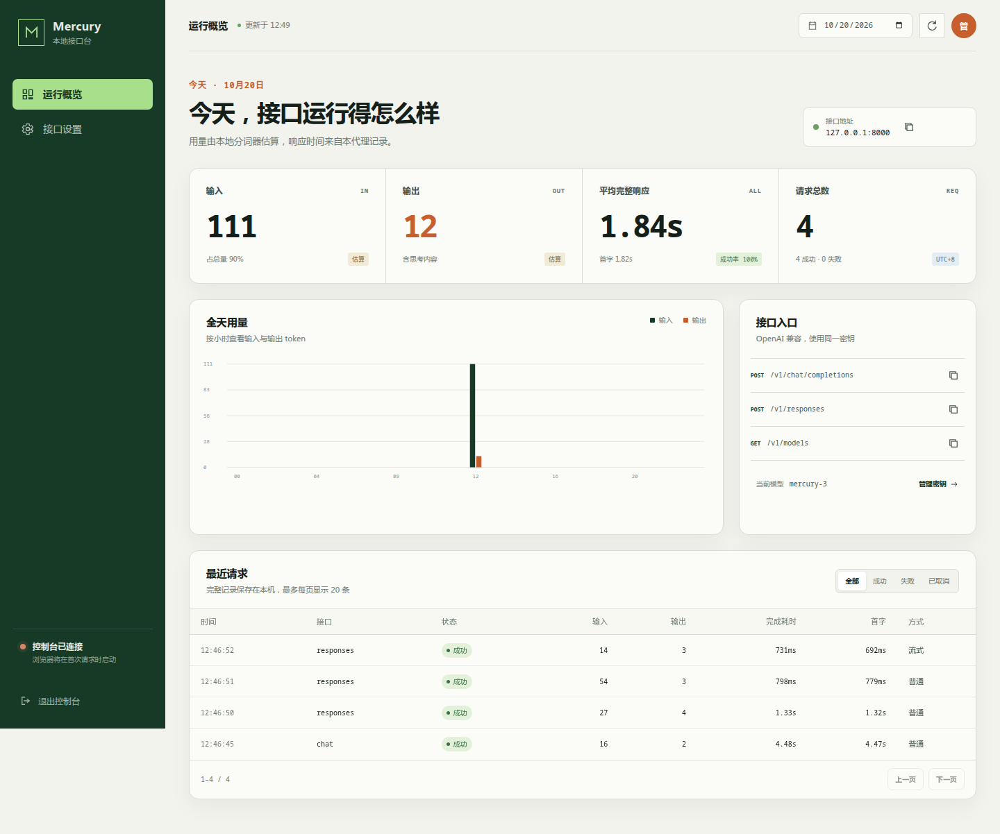
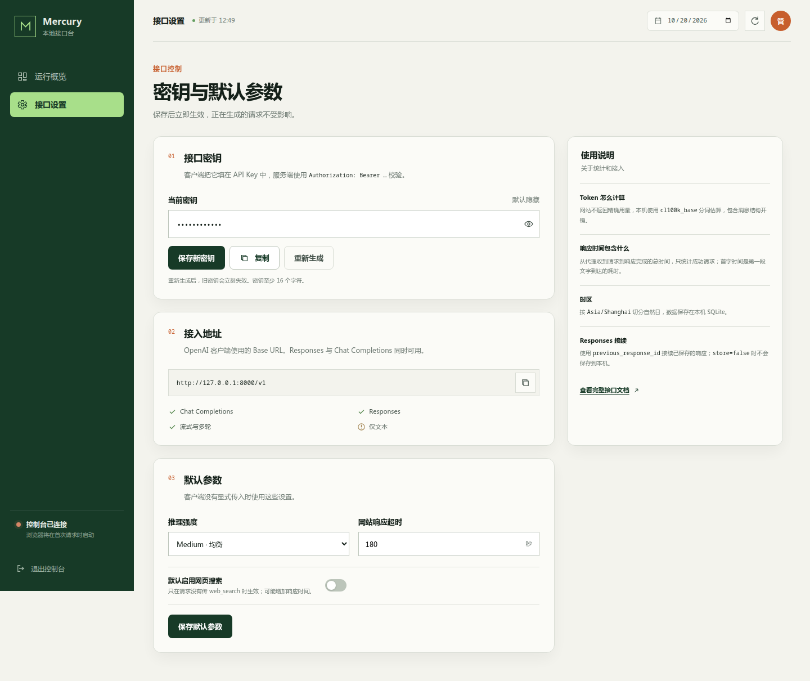

# Mercury Free API

把 `https://chat.inceptionlabs.ai/` 的当前网页对话转换成 OpenAI 兼容接口，并附带中文 Web 控制台。

当前网页展示的模型是 Mercury 3。请求使用网页实际的 `/api/chat` 接口、`/api/session` 会话令牌和流式事件，没有沿用旧版项目中的 `/api/chat/completions` 或 `lambda.mercury-coder-small`。



## 功能

- OpenAI 兼容的 `/v1/chat/completions` 与 `/v1/responses`
- 普通回复、流式 SSE、多轮对话、思考内容
- Chat Completions 与 Responses 函数工具调用，支持工具结果回传
- 兼容常见 OpenAI 客户端可选参数，不再因 `prompt_cache_key`、`include` 等字段拒绝请求
- Responses 的创建、读取、删除、输入列表、`include` 参数及 `previous_response_id` 接续
- 中文 Web 控制台，查看今日输入 token、输出 token、平均完整响应时间、首字时间、成功率和请求记录
- 本地估算 token 用量，按 `Asia/Shanghai` 时区切分自然日
- 在控制台查看、复制、重新生成和保存接口密钥
- 设置默认推理强度、网页搜索开关和网站响应超时
- 浏览器常驻复用、会话自动刷新、并发限制、超时及客户端断开清理
- SQLite 本地持久化，接口密钥和管理密码均为独立凭证
- 桌面和手机响应式布局

网站不返回真实 token 计数，因此控制台和接口中的用量均为本地 `cl100k_base` 分词估算，响应中明确标记 `usage_estimated: true`。

## 快速开始

需要 Python 3.10 或更高版本。

```bash
python3 -m venv .venv
source .venv/bin/activate
python -m pip install -r requirements.txt
python -m playwright install chromium
python proxy.py
```

Windows 激活虚拟环境改为：

```powershell
.venv\Scripts\Activate.ps1
```

Windows 没有 `python3` 时，第一条命令使用 `python -m venv .venv`。

Linux 缺少浏览器系统依赖时：

```bash
python -m playwright install --with-deps chromium
```

启动后打开：

| 地址 | 用途 |
| --- | --- |
| `http://127.0.0.1:8000/admin` | Web 控制台 |
| `http://127.0.0.1:8000/v1` | OpenAI 兼容接口 |
| `http://127.0.0.1:8000/docs` | OpenAPI 交互文档 |

第一次启动会生成两份独立凭证：

- `data/admin-password.txt`：控制台管理密码
- `data/proxy-key.txt`：客户端使用的接口密钥

浏览器在第一次对话时启动，首次回复会慢一些。`/health` 中的 `browser_ready` 只表示浏览器已经启动，不表示网站此刻一定能完成生成。

## Web 控制台

控制台提供两个页面。

运行概览显示当天输入和输出 token 估算、平均完整响应时间、平均首字时间、请求数、成功率和 24 小时用量。下方请求记录支持按成功、失败和已取消筛选，并显示每条请求的输入、输出、总耗时与首字时间。

接口设置可以查看或替换接口密钥、复制 Base URL、设置默认推理强度和搜索开关，以及调整网站超时。



管理密码只用于进入本地控制台，修改接口密钥不会让已登录的控制台失效。管理会话有效期为 12 小时。

## 客户端接入

| 设置 | 内容 |
| --- | --- |
| 接口类型 | OpenAI 兼容 |
| Base URL | `http://127.0.0.1:8000/v1` |
| API Key | `data/proxy-key.txt` 或控制台中设置的密钥 |
| 模型 | `mercury-3` |

`mercury` 是 `mercury-3` 的别名。模型列表固定返回 `mercury-3`。

Chat Completions 普通回复：

```bash
curl http://127.0.0.1:8000/v1/chat/completions \
  -H 'Authorization: Bearer 你的接口密钥' \
  -H 'Content-Type: application/json' \
  -d '{"model":"mercury-3","messages":[{"role":"user","content":"用中文介绍一下你自己"}]}'
```

Responses 普通回复：

```bash
curl http://127.0.0.1:8000/v1/responses \
  -H 'Authorization: Bearer 你的接口密钥' \
  -H 'Content-Type: application/json' \
  -d '{"model":"mercury-3","input":"用中文介绍一下你自己"}'
```

OpenAI Python 客户端：

```bash
python -m pip install openai
```

```python
from pathlib import Path
from openai import OpenAI

client = OpenAI(
    base_url="http://127.0.0.1:8000/v1",
    api_key=Path("data/proxy-key.txt").read_text().strip(),
    timeout=240,
    max_retries=0,
)

chat = client.chat.completions.create(
    model="mercury-3",
    messages=[{"role": "user", "content": "写一首关于秋天的诗"}],
)
print(chat.choices[0].message.content)

response = client.responses.create(
    model="mercury-3",
    input="用一句话介绍你自己",
    reasoning={"effort": "low"},
)
print(response.output_text)
```

Responses 流式输出：

```python
stream = client.responses.create(
    model="mercury-3",
    input="写一首关于秋天的诗",
    stream=True,
)

for event in stream:
    if event.type == "response.output_text.delta":
        print(event.delta, end="", flush=True)
```

使用 `previous_response_id` 接续上下文：

```python
first = client.responses.create(
    model="mercury-3",
    input="请记住暗号是晨星。",
)

second = client.responses.create(
    model="mercury-3",
    input="暗号是什么？",
    previous_response_id=first.id,
)
print(second.output_text)
```

Chat Completions 多轮对话需要每次传入完整 `messages`。支持 `system`、`developer`、`user` 和 `assistant` 文本消息；`developer` 会转成网页使用的 `system` 消息。

## 工具调用

网页本身没有客户端函数调用协议。代理会把 OpenAI 工具定义转换成受约束的系统提示，解析模型返回的 `<tool_calls>` JSON，再还原成标准 OpenAI 工具调用。

Chat Completions 工具定义：

```python
tools = [{
    "type": "function",
    "function": {
        "name": "get_weather",
        "description": "查询城市当前天气",
        "parameters": {
            "type": "object",
            "properties": {"city": {"type": "string"}},
            "required": ["city"],
        },
    },
}]

first = client.chat.completions.create(
    model="mercury-3",
    messages=[{"role": "user", "content": "北京天气怎么样？"}],
    tools=tools,
    tool_choice="auto",
)

call = first.choices[0].message.tool_calls[0]

messages = [
    {"role": "user", "content": "北京天气怎么样？"},
    first.choices[0].message.model_dump(exclude_none=True),
    {
        "role": "tool",
        "tool_call_id": call.id,
        "content": '{"temperature_c":26,"weather":"晴"}',
    },
]

final = client.chat.completions.create(
    model="mercury-3",
    messages=messages,
    tools=tools,
)
print(final.choices[0].message.content)
```

Responses 工具定义使用平铺结构：

```python
tools = [{
    "type": "function",
    "name": "get_weather",
    "description": "查询城市当前天气",
    "parameters": {
        "type": "object",
        "properties": {"city": {"type": "string"}},
        "required": ["city"],
    },
}]

first = client.responses.create(
    model="mercury-3",
    input="上海天气怎么样？",
    tools=tools,
)

call = next(item for item in first.output if item.type == "function_call")

final = client.responses.create(
    model="mercury-3",
    input=[{
        "type": "function_call_output",
        "call_id": call.call_id,
        "output": '{"temperature_c":29,"weather":"多云"}',
    }],
    previous_response_id=first.id,
    tools=tools,
)
print(final.output_text)
```

支持 `tool_choice` 的 `none`、`auto`、`required` 和指定函数，支持 `parallel_tool_calls`。Chat 流式响应输出标准 `delta.tool_calls`；Responses 流式响应输出 `response.function_call_arguments.delta` 与完成事件。

请求传入工具时，代理需要等模型完整返回后才能可靠判断是否形成工具调用，因此正文会在生成完成后通过 SSE 分段发送。没有传入工具时仍保持实时流式输出。

## 接口范围

| 接口 | 支持内容 |
| --- | --- |
| `GET /v1/models` | 模型列表 |
| `POST /v1/chat/completions` | 普通回复与流式回复 |
| `POST /v1/responses` | 文本响应、普通与流式 |
| `GET /v1/responses/{id}` | 读取已保存响应 |
| `DELETE /v1/responses/{id}` | 删除已保存响应 |
| `GET /v1/responses/{id}/input_items` | 读取响应对应的输入历史 |
| `GET /docs` | OpenAPI 文档 |
| `GET /openapi.json` | OpenAPI 规范 |

`reasoning_effort` 支持 `high`、`medium`、`low`、`instant`，`none` 会映射成 `instant`。Responses 中可使用 `reasoning.effort`。

`web_search` 映射到网页自带的搜索开关。Responses 也接受顶层 `web_search`。返回内容目前不包含结构化引用列表。

Responses 接受官方客户端的 `include` 参数。网页没有对数概率或加密推理数据，因此 `message.output_text.logprobs`、`reasoning.encrypted_content` 等可选字段不会被伪造。

思考文字在 Chat Completions 中位于 `reasoning_content`，在 Responses 中作为 reasoning 输出项及 `response.reasoning_summary_text.delta` 事件返回。

当前仅处理文本与函数工具。图片、文件上传、嵌入向量尚未支持。`prompt_cache_key`、`temperature`、`top_p`、`max_tokens`、`max_output_tokens`、`stop`、`seed`、`service_tier`、`user`、`truncation`、`background`、`safety_identifier` 等常见客户端参数会被接受。网页无法实现的部分不会改变上游生成，也不会再返回“不支持参数”的错误。模型名称、消息结构等无效内容仍会返回 400。

## 统计口径

每条完成的请求会记录：

- 输入 token 估算
- 输出 token 估算，包括思考内容
- 完整响应耗时
- 首个文字或思考片段到达时间
- 接口、模型、流式方式与成功状态

平均完整响应和首字时间只统计成功请求。控制台显示的是本代理记录的耗时，包含等待网站、排队和流式传输时间。

数据保存在 `data/proxy.sqlite3`。响应状态为成功或未完成时，Responses 内容可保存供 `previous_response_id` 使用；`store=false` 时不写入本地响应表。

## 配置

复制 `.env.example` 为 `.env` 后修改，或在系统中设置环境变量。

| 变量 | 默认值 | 说明 |
| --- | --- | --- |
| `PROXY_API_KEY` | 自动生成 | 首次建库时指定接口密钥 |
| `ADMIN_PASSWORD` | 自动生成 | 首次建库时指定控制台管理密码 |
| `PROXY_HOST` | `127.0.0.1` | 监听地址 |
| `PROXY_PORT` | `8000` | 监听端口 |
| `PROXY_DATA_DIR` | `data` | SQLite 与凭证目录 |
| `PROXY_TIMEZONE` | `Asia/Shanghai` | 自然日统计与网页时区 |
| `MAX_CONCURRENCY` | `1` | 同时发往网站的请求数 |
| `UPSTREAM_TIMEOUT` | `180` | 网站生成超时时间 |
| `BROWSER_HEADLESS` | `1` | 设为 `0` 显示浏览器窗口 |
| `BROWSER_EXECUTABLE_PATH` | Playwright Chromium | 指定已有浏览器路径 |

`PROXY_API_KEY` 和 `ADMIN_PASSWORD` 用于第一次创建数据库。数据库存在后，以控制台保存的值为准。

默认监听 `127.0.0.1`，避免无意暴露到局域网。需要公网或远程访问时，建议放在 HTTPS 反向代理后面，并限制来源。不要把 `data/` 目录提交到仓库。

如果网站要求手动验证，在有桌面的机器上设置 `BROWSER_HEADLESS=0`，启动后发起一次对话，在弹出的浏览器中按网页提示操作。程序不会自动破解验证码。

## 容器运行

```bash
docker compose up --build -d
docker compose exec inception-proxy cat /app/data/admin-password.txt
docker compose exec inception-proxy cat /app/data/proxy-key.txt
```

Compose 默认只把端口绑定到主机 `127.0.0.1`，数据保存在 `proxy-data` 卷中。

该服务使用常驻 Chromium，并依赖单个进程内的浏览器和 SQLite 状态。不要为一个实例启动多个 Uvicorn worker。

## 项目结构

```text
.
├── proxy.py             应用入口、OpenAI 路由、请求校验
├── upstream.py          浏览器会话、网页请求与流式读取
├── protocol.py          Chat Completions 数据协议与网站事件转换
├── responses_api.py     Responses 请求与流式响应构建
├── generation.py        单次生成、用量和耗时记录
├── tooling.py           工具调用提示解析与结果还原
├── storage.py           SQLite、分词估算、管理会话
├── admin.py             控制台 API、认证与设置
├── static/              控制台 HTML、CSS、JavaScript
├── assets/              本地 cl100k_base 分词表
├── docs/                控制台截图
├── test_proxy.py        自动检查
├── Dockerfile
└── compose.yaml
```

## 检查

```bash
python -m pip install -r requirements-dev.txt
python -m pytest -q
```

当前自动检查共 44 项，覆盖中文流式拆包、事件转换、Chat Completions、Responses、常见可选参数兼容、函数工具调用与结果回传、上下文接续、统计累计、管理登录、CSRF、限流、密钥轮换、客户端断开和已关闭浏览器的退出清理。

本地真实联调还验证了：

- OpenAI Python 客户端调用 Chat Completions
- OpenAI Python 客户端调用 Responses 普通、流式与 `previous_response_id`
- Chat Completions 与 Responses 的完整工具调用及工具结果回传
- Chat 与 Responses 的流式工具调用事件
- 控制台桌面与 390px 手机布局
- 管理登录、密钥显示、复制、参数保存与刷新持久化

## 已知限制

本实现依赖 Inception Chat 当前网页的内部接口，网站更新后可能需要调整。网页会话和质量限制由网站决定，代理没有绕过账号、人机验证或付费限制。请遵守网站服务条款并控制调用频率。
